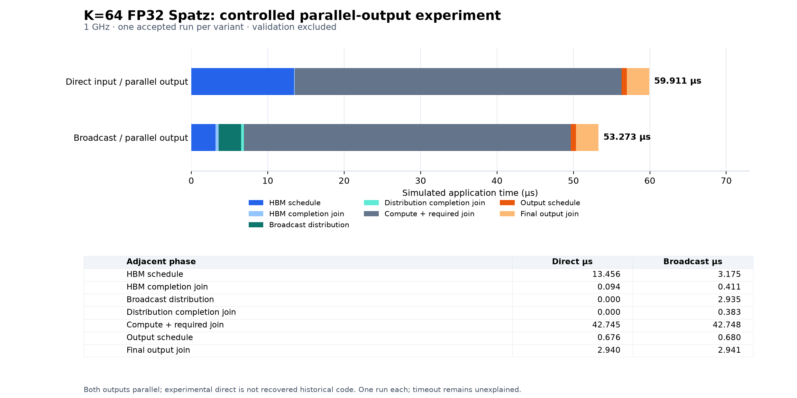

# Controlled V2 comparison: identical parallel output policy

This is a separate experimental pair, not a replacement for checkpoint
`082c5e8bbd37975079168f82f2fd9a91fc87ba88` or the [original results](SPATZ_GRID_V2_RESULTS.md).
The original **1.965× input-readiness / 1.196× complete-schedule** comparison,
serialized-output direct driver, accepted captures, JSON and charts are unchanged.

The new `direct_parallel` variant derives from the benchmark-4-based V2 direct
reconstruction and substitutes benchmark-5's parallel output policy. It is **new
experimental code, not recovered historical benchmark 4**. No original benchmark
source is replaced. See the [experimental source](../../soft_hier/flex_cluster_sdk/app_example/gemm/spatz_grid_v2/experimental/README.md)
and [CLI workflow](../../tools/socdaml/spatz_grid_v2/README.md#separate-controlled-parallel-output-experiment).

## Conditions and checks

Both use A[256][64] × B[64][256] → C[256][256], FP32, 64×64 output tiles on a
4×4 grid, three cores per cluster, core 0 executing Spatz and DM core 2 issuing
DMA. All 16 clusters use the same accepted GEMM bytes at 0x803f0000. Clock is
1 GHz; the full runtime model fingerprint matches the pinned accepted profile,
including ISA, topology, HBM configuration, clocks and timing. Matrix addresses
retain west node 0 placement. Delivered inputs and HBM output hashes match.

Prelaunch review confirmed the only source change is an experimental header/
policy definition and output selection. Direct input loops, initialization,
precision, GEMM, output function, completion waits, probe definitions and
validation remain unchanged. The output DMA issue/wait block is byte-identical
between the new ELF and existing broadcast ELF; address setup registers, stack
spills and relocations differ under whole-function optimization. The surrounding
scalar programs are not byte-identical. See [source/disassembly review](reproduction/spatz_grid_v2/controlled-prelaunch.json).
Three targeted host checks passed for the selection guard, rejection of serial/
late output and filename-only config normalization. Only the new application
was compiled; the installed environment/model and existing broadcast ELF were reused.

Exactly two simulations ran sequentially, one per variant, with fixed 300-second /
64-MiB limits and no retries. Each passed all 262,144 numerical words, 82,944
expected vector operations (5,184 on each of 16 clusters), DMA addressing/strides,
compute/vector/DMA completion boundaries, input/workload equivalence, and
source/model/kernel preservation. Both showed overlapping output DMA transactions.
The sparse trace allowlist, continuously drained PTY and concurrent stack sample
attempts were reused. Archives include exact CLI/simulator argv, relevant non-secret
environment, source/config/checker snapshots, validation and hashes.

## Measured results

All values below are simulated µs, not host elapsed time. One observation per
controlled variant; no averaging with the original captures.

| Boundary | Direct input, parallel output | Broadcast input, parallel output |
|---|---:|---:|
| Complete input readiness t0..t4 | 13.550 | 6.904 |
| Compute + required synchronization t4..t5 | 42.745 | 42.748 |
| Output + final synchronization t5..t7 | 3.616 | 3.621 |
| Continuous application t0..t7 | 59.911 | 53.273 |

Input-readiness speedup (direct / broadcast) is **1.963×**,
saving **6.646 µs (49.05%)**.
Application speedup is **1.125×**, saving
**6.638 µs (11.08%)**.
Broadcast compute/join is 0.003 µs longer and output/final join is **0.005 µs
longer**; the 6.646-µs input saving becomes a 6.638-µs application saving.

| Adjacent measured phase | Direct µs | Broadcast µs |
|---|---:|---:|
| HBM input schedule | 13.456 | 3.175 |
| Input completion join | 0.094 | 0.411 |
| Distribution schedule | 0.000 | 2.935 |
| Distribution completion join | 0.000 | 0.383 |
| Compute + required join | 42.745 | 42.748 |
| Output schedule | 0.676 | 0.680 |
| Final output join | 2.940 | 2.941 |

Input readiness includes the HBM fetch schedule, its required completion join,
all broadcast distribution to consuming clusters, and the distribution join.
It does not compare direct input with only the initial broadcast HBM fetch.
Issue/wait probes include scalar scheduling and DMA waits; raw DMA completion
is separately checked within those probes. Actual DATA-IN completion envelopes
are 13.234 / 6.682 µs (direct/broadcast), from the first actual
DMA start through the last input/distribution completion, including gaps; they
exclude readiness-join overhead. These are envelopes, never sums of overlapping
per-cluster DMA durations.

Both output implementations issue one identical 2D C-tile DMA per DM core:
256-byte rows, 256/1024-byte source/destination strides, 64 repeats. Every DM
waits for its local DMA completion, records t6, and participates in the same
required global join before t7. There is no serialized output loop in either
controlled run. Same policy does not imply identical duration: measured output
schedule differs by 4 ns and final join by 1 ns. Disassembly contains differing
scalar setup/spill instructions, but the evidence does not establish the cause
of this five-cycle duration difference.

The compute phase includes GEMM and its required global join. Vector work ends
before compute-return and output handoff. The final output join is included in
the application interval. Validation-only barriers, lossless exports, reference
checking and HBM readback occur after t7 and are excluded. Exact boundary
definitions remain those in the [original measurement document](SPATZ_GRID_V2_RESULTS.md).

The [machine-readable results](reproduction/spatz_grid_v2/controlled-parallel-results.json)
are the chart source; [SVG](reproduction/spatz_grid_v2/controlled-parallel-phases.svg)
is also available. Adjacent phase sums equal the continuous interval.

## Evidence and limits

Native evidence, with adjacent `.tar.gz` archives:

- `logs/spatz-grid-v2-direct_parallel-zg7i0wnu`: 76.592 host seconds, 19,105,027 bytes.
- `logs/spatz-grid-v2-broadcast-9d4vsocw`: 79.298 host seconds, 19,065,262 bytes.
- `logs/spatz-grid-v2-build-pqckwors`: compile commands, dumps and prelaunch review;
  its frozen prelaunch archive is separately hashed in the results JSON.

Result JSON contains report/archive/ELF and every captured artifact hash, CLI argv,
input/output hashes, pinned model fingerprint, kernel identity and individual
phase values. [Evidence checks](reproduction/spatz_grid_v2/controlled-evidence-checks.json)
confirm archive artifact hashes and unchanged original reports/archives/checkpoint
assets. Raw traces/builds/toolchains are retained outside Git under native/logs.

## Review of the 15-cycle direct-input difference

The [input-difference review](reproduction/spatz_grid_v2/controlled-input-delta-review.json)
compares the original accepted direct capture, the experimental capture, exact
input source regions and existing source-mapped disassembly. No substantive
unintended input-policy change was found:

- The input helpers and t0-through-t4 source region are identical. Both retain
  y-major/x-minor direct scheduling, A then B, a local DMA completion wait after
  each transfer, 32 scheduling barriers and one required completion join per core.
- All 32 measured input DMA transfers match in observed order, worker,
  transaction ID, type, source/destination, size, strides and repeats. The
  delivered input hashes match. Required synchronization remains equivalent;
  the compiled global-barrier function bytes are identical.
- The original accepted and packaged direct disassembly instructions match.
  Experimental scalar register assignments, stack operations and code addresses
  differ. These static differences do **not** establish the dynamic cycle cause.

| Input boundary, cycles at 1 GHz | Original direct | Experimental direct | Experimental − original |
|---|---:|---:|---:|
| Input schedule t0..t1 | 13,473 | 13,456 | −17 |
| Required input join t1..t2 | 92 | 94 | +2 |
| Complete readiness t0..t4 | 13,565 | 13,550 | **−15** |

There is no broadcast/distribution phase in either direct variant (t2=t3=t4).
The same net difference can be located relative to raw DMA completions:
t0-to-first-DMA start is 123/127 cycles (+4); actual input DMA envelope is
13,259/13,234 cycles (−25); last-DMA-to-readiness is 183/189 cycles (+6).
Thus +4 −25 +6 = −15. These measured intervals locate the difference but do not
explain its cause. **The exact 15-cycle cause remains unresolved.** No timings
were adjusted or forced to match, and no further simulation was run.

Broadcast phases match the original accepted broadcast exactly. The controlled
results characterize the new pair; they do not overwrite the original
**1.965× input-readiness / 1.196× application** complete-schedule comparison.
The matched-parallel-output comparison is **1.963× / 1.125×**, respectively.
Neither comparison claims an isolated hardware-only broadcast effect.

One new run each provides no variability estimate. The historical intermittent
timeout remains unexplained and is not claimed fixed; no timeout investigation
was started. Fresh-machine provisioning and relocation remain unverified. This
is the current reconstruction, not exact reproduction of the historical slides.
Finalization used existing evidence only: no new simulation, environment rebuild
or unrelated edit. This controlled experiment is recorded in a separate local
checkpoint; no push was performed.
