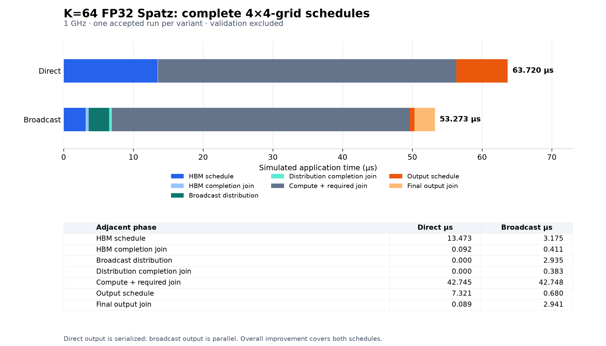

# Accepted native Spatz grid V2 comparison

**Current reconstruction, 2026-10-26:** complete application time is **63.720 µs
direct / 53.273 µs broadcast**, a **1.196103×** speedup and **10.447 µs (16.395%)**
saved. The original reference pair passes exact full-word validation and all-worker
vector/DMA completion checks. An additional repository-CLI run per variant now
passes end to end with **zero differences in all measured durations**. There are
two accepted observations each, without a statistical variability estimate.
Earlier intermittent startup timeouts remain unexplained.

Direct output is serialized; broadcast output is parallel. These numbers compare
the two complete schedules. They do not attribute all improvement to input
broadcasting or claim exact reproduction of the historical presentation. The
supervisor's final source, historical placement/overlap changes and raw results
are unavailable. No parameter was tuned to match a historical speedup.

## Workload and machine

| Item | Both variants |
|---|---|
| Workload | A[256][64] × B[64][256] → C[256][256], row-major FP32 |
| Per cluster | One 64×64 output tile, K=64 |
| Grid | 4×4 clusters; three cores each; core 0 executes Spatz, DM core 2 issues DMA |
| Spatz | Four function units; four 64-bit VLSU ports; e32/m4, observed VL=64 |
| Clock | 1 GHz, so one cycle = one simulated ns |
| Local buffers | A=0x10000, B=0x14000, C=0x18000; fixed disjoint offsets |
| HBM | Four west and four north channels instantiated; surviving address mapping places these matrices in west node 0 |
| Inputs | Identical dense, coordinate-sensitive integer-valued FP32 patterns; products/sums exactly representable |
| Validation | Delivered A/B, local C and HBM C: 262,144 raw words per variant, including all 65,536 final outputs |

The proposal's original P1/P2 scope and the five recovered K=256 scalar programs
are distinct historical artifacts. This K=64 vector application is a supplemental
reconstruction. The exact validated files live under
[`gemm/spatz_grid_v2/`](../../soft_hier/flex_cluster_sdk/app_example/gemm/spatz_grid_v2/).
The recovered `benchmark_4.c` / `benchmark_5.c` originals remain untouched.

## Exact probes and exclusions

Each cluster's DM core records adjacent cycle probes t0…t7. The phase table uses
worker 0's probes, with all-worker raw DMA/vector envelopes checked against the
corresponding joins. The continuous interval **t7−t0** includes completed input,
compute, required synchronization and DATA-OUT through final completion. Allocation,
local/HBM poisoning, initial input generation, vector configuration and the BEGIN
print precede t0. There are no validation/checksums/prints or validation-only
barriers inside t0…t7.

| Probe | Includes |
|---|---|
| t0→t1 | Original HBM input scheduling, its scheduling barriers, software issue and local DMA waits. In broadcast, other leaders may still be finishing when master t1 is sampled. |
| t1→t2 | Required input/leader completion join, including remote DMA tails and coordination. |
| t2→t3 | Broadcast A-row and B-column distribution schedule, including its barriers, issue and local completion waits. Zero for direct. |
| t3→t4 | Required distribution completion join, including remote distribution tails. Zero for direct. |
| t4→t5 | Spatz calls and required global compute completion join, plus probe/caller bookkeeping. |
| t5→t6 | Original DATA-OUT schedule: 16 serialized stores for direct; parallel per-cluster stores for broadcast. Master progress alone does not complete all parallel stores. |
| t6→t7 | Required final join; includes outstanding remote output completion and synchronization. |

**Complete input readiness is t4−t0**, not just the initial HBM fetch. Broadcast's
complete stage includes HBM fetching, all A/B distribution, and both required
joins. The source preserves a global input join rather than the slides' described
per-cluster early-start overlap.

Every DMA also has an issue/wait probe span. That span includes software overhead;
it is not pure bus-flight latency. Independently, matched raw iDMA frontend
Finished events support an **actual DATA-IN engine envelope**: earliest HBM
transaction start to latest input completion, including BA/BB distribution for
broadcast. It includes inter-transfer scheduling gaps, and is **not DMA-only
hardware service time**. No pure-DMA bandwidth/latency or sum-of-overlapping-
durations speedup is claimed. The supported envelope comparison uses the same
frontend event boundaries in both captures.

After t7, an additional validation-only global barrier precedes INTERVAL_END.
Worker serialization barriers then surround COMPUTE/TIMES/DMA/WORDS64 printing;
HBM output readback and its full-word print also occur there. The final
validation-only barrier before END/EOC is excluded. Core-0 prints its stored
compute timestamps after timing. The parser requires all evidence records after
INTERVAL_END and before END; all 16 actual validation readbacks begin after
every worker's t7. Validation is not inferred from a checksum or exit code.

## Measured phases

All values below are **simulated µs**, converted from integer ns in
[`accepted-results.json`](reproduction/spatz_grid_v2/accepted-results.json).

| Adjacent master phase | Direct | Broadcast |
|---|---:|---:|
| HBM input schedule | 13.473 | 3.175 |
| Required HBM/input completion join | 0.092 | 0.411 |
| Broadcast distribution schedule | 0.000 | 2.935 |
| Required distribution completion join | 0.000 | 0.383 |
| Compute + required join | 42.745 | 42.748 |
| DATA-OUT schedule/master progress | 7.321 | 0.680 |
| Final output completion/synchronization | 0.089 | 2.941 |
| **Continuous application** | **63.720** | **53.273** |

[Vector chart](reproduction/spatz_grid_v2/phase-breakdown.svg) ·
[chart generator](../../tools/socdaml/spatz_grid_v2/plot_results.py)

Broadcast's explicit input joins total **0.794 µs**, but that is not pure barrier
overhead: the last HBM completion occurs 318 ns after master t1; the last
distribution completion occurs 279 ns after t3. Input-ready t4 is 104 ns after
that last completion. In direct, final input completion is followed by 91 ns
of schedule bookkeeping and the 92-ns explicit input join.

Every worker's compute call is **42.654 µs** in both variants. Direct per-worker
join waits are 84–92 ns (worker 0: 88 ns); broadcast waits are 85–93 ns (worker 0:
89 ns). Their phase totals include these waits; do not add them again. Every
worker's final vector completion precedes its end probe by five cycles.

## Matching-boundary comparisons

Speedup = direct time / broadcast time. Time saved = direct − broadcast.

| Metric | Direct µs | Broadcast µs | Speedup | Saved µs | Reduction |
|---|---:|---:|---:|---:|---:|
| Complete input through readiness | 13.565 | 6.904 | 1.964803× | 6.661 | 49.104% |
| Actual DATA-IN envelope, including distribution | 13.259 | 6.682 | 1.984286× | 6.577 | 49.604% |
| DATA-OUT through final completion | 7.410 | 3.621 | 2.046396× | 3.789 | 51.134% |
| **Continuous application** | **63.720** | **53.273** | **1.196103×** | **10.447** | **16.395%** |

The software issue/wait input envelopes are separately 13.275 / 6.699 µs.
The engine envelopes above exclude that software prefix/tail. No overlapping
per-cluster service durations are summed.

Application time saved decomposes into **6.661 µs input + 3.789 µs output −
0.003 µs compute-phase increase = 10.447 µs**. The output difference is material:
actual direct output DMAs do not overlap; broadcast output DMAs do. The master
broadcast output phase of 0.680 µs alone would understate completed output cost;
the required final join brings it to 3.621 µs.

## Provenance, model revisions and compatibility

| Component | Recorded revision/version |
|---|---|
| SoCDAML native source base | `707cc6f0db370d16f608de7b9ff86e9c758d95e9` |
| GVSoC/core | `bda268a4808708a48eab21981c7d6bbced1577d7` |
| PULP models | `3ca2016d056dda72317e27c4319fc6174b5f8c4d` |
| RISC-V toolchain | `935b263c8ef7f250819c74aeb7736c87ad87ef2b` |
| GCC | 14.2.0, `04696df09633baf97cdbbdd6e9929b9d472161d3` |
| DRAMSys | `8e021eada2cb937d5be24dbd02f3980e2193d6ec` |
| SystemC | 2.3.3, `38b8a2c61aafe40de44296bee0c9c28ac4e80b01`, pthread coroutines |

These are **base revisions plus native patches**, not claims of pristine upstream
binaries. Exact configured source, installed model, dependency and compiler
hashes are packaged under
[`tools/socdaml/spatz_grid_v2/reference/`](../../tools/socdaml/spatz_grid_v2/reference/).
Target flags are `-march=rv32imafdv_zfh -mabi=ilp32d -mcmodel=medlow -O3 -g
-fno-builtin -fno-tree-vectorize -fno-common -ffunction-sections -fno-lto`.

Native changes include documented macOS loader/link/SDK paths, SystemC/DRAMSys
integration, virtual memory-memcheck dispatch across plugins, FP receiver build
and offload separation, the LightRedmule variadic diagnostic repair, Spatz's 70
`uint64_t` host-container declarations, and the cycle CSR callback using the
existing simulated clock. No instruction latency or GEMM algorithm was tuned
for these results. The retained [compatibility diffs and records](reproduction/spatz_grid_v2/compatibility/)
make the patch set inspectable. They are provenance, not an environment installer;
the packaged runner never reapplies them.

Shared kernel bytes at 0x803f0000:
`c8a8a2f32342ef6cb19921a5fb3f25cb8de9467b283562d2a54be7e086c7e3d6`.
Both runs have identical delivered-input hash
`35d2f3b8a0671453efcef31dd5b50583edaaa7edfed0f7c994746fe98937e78e`
and final-output hash
`29069b77baa6bb64edc7217dc8e15aa457d80e8446f41ceb94b4366ccf1d0206`.

| Accepted evidence directory under native/logs | Report SHA-256 | Archive SHA-256 |
|---|---|---|
| `presentation-grid-direct-v2-0puwdfmc` | `03493246dfd5464c741eae88a2c3915b0ebe3a88ac30cb09104d52adc63739be` | `74ce6e5c55cfe0cbe143a12130eb511342ae56c6e8feeb746e2fca11df4cbd96` |
| `presentation-grid-broadcast-v2-pty-69p_kpqx` | `510b78f53cb7ec04ec2cf690b83fddee7aae2c2f5b0c03d91352c474214cf54c` | `3bc7e0f396459368b4571f9bb7d7e3fd88ed102d446005b8d17705a4169f200f` |

Direct ELF SHA-256 is
`0116809c593e837396d53eef079194c2932ba0048be596786535fd6e0da304be`;
broadcast is `3714d21b60f7091147ca384bcfd4b85aff9a7e3211e1870a0406fac963618544`.
All 24 direct and 33 broadcast artifact hashes and archive members were verified
during consolidation. Original captures, runner scripts and failed diagnostics
remain preserved. Large raw traces/ELFs stay in native/logs rather than being
duplicated into the cleaned repository; the JSON records their identities.

The original accepted direct used two event filters and regular-file output; accepted
broadcast used the inspected five-filter event allowlist and continuously drained
PTY. Runtime model, inputs, clock, kernel and measurement definitions match;
host observation differs and may perturb host scheduling. Earlier direct and
broadcast startup timeouts remain unexplained. This success establishes a
validated current program-pair checkpoint, not resolution of the intermittent
failure, a historical-slide match, or a repeatability distribution.

## Reproduction and packaging status

Use the [repository workflow README](../../tools/socdaml/spatz_grid_v2/README.md)
for check/build/run/validate/evidence-to-JSON/chart commands. It requires no
temporary extraction or code stored only in logs. Explicit `run` commands are
bounded to 300 seconds / 64 MiB and never retry; exit status alone is insufficient.

Consolidation performed no simulations or environment/model rebuilds. It checked
existing paths/dependencies, revalidated both accepted logs through packaged
imports, ran three focused packaging/guard checks, compiled both applications
using the existing toolchain, verified that **every allocated section's bytes
and address match the accepted corresponding ELF**, and generated/visually inspected the JSON-backed
PNG/SVG chart. The full earlier native functional test campaign was not repeated.

### Packaged workflow verified end to end

After the simulation-free consolidation, the repository CLI ran **direct once,
then broadcast once**, using `logs/spatz-grid-v2-build-qcdpszj6/`, each capped at
300 seconds / 64 MiB, without retries. Both passed all numerical, workload,
timing-boundary and kernel/model preservation checks. All measured adjacent
phases, per-worker compute/join durations and input/output DMA envelopes matched
their respective original accepted run exactly (delta **0 cycles/ns**).

| Metric | Original direct / packaged direct µs | Original broadcast / packaged broadcast µs | Delta each |
|---|---:|---:|---:|
| Complete input readiness | 13.565 / 13.565 | 6.904 / 6.904 | 0 ns |
| Actual DATA-IN DMA envelope | 13.259 / 13.259 | 6.682 / 6.682 | 0 ns |
| Continuous application | 63.720 / 63.720 | 53.273 / 53.273 | 0 ns |

Additional evidence under native/logs:

- `spatz-grid-v2-direct-63hpp47d`: normal exit, 111.088 host seconds,
  19,189,171 bytes, all 262,144 words / 82,944 vector operations checked.
- `spatz-grid-v2-broadcast-1ykiy6_p`: normal exit, 106.424 host seconds,
  19,065,279 bytes, all 262,144 words / 82,944 vector operations checked.

Host durations are capture diagnostics, not performance. Exact argv, archive/
report/ELF and artifact hashes, all phase deltas and sample outcomes are retained
in [`packaged-workflow-verification.json`](reproduction/spatz_grid_v2/packaged-workflow-verification.json).
The original `accepted-results.json` and phase chart remain unchanged; no
averaging or silent replacement occurred.

Remaining limits: the workflow is for the existing pinned native profile,
not fresh-machine provisioning, arbitrary relocation or an arbitrary-profile
port. Raw evidence availability is required for offline validation. Two matching
observations per variant are a small repeatability check, not a distribution or
stability guarantee. The intermittent timeout remains unexplained and is not
claimed fixed.

## Separate controlled experiment

The [parallel-output controlled experiment](SPATZ_GRID_V2_CONTROLLED_OUTPUT.md)
compares a new direct-input/parallel-output derivative against the existing
broadcast-input/parallel-output variant. Its separate data and charts do not
replace the original 1.965× input-readiness and 1.196× complete-schedule results
above. The original direct variant retains serialized output.
